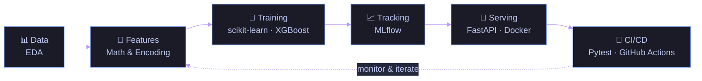

<em>Turning rigorous mathematical foundations into production-grade machine learning systems — from exploratory analysis to containerized deployment.</em>

 

## 🚀 Featured Projects

<table width="100%">
<tr>
<td width="50%" align="center" valign="top">

 

</td>
<td width="50%" align="center" valign="top">

 

</td>
</tr>
<tr>
<td width="50%" align="center" valign="top">

 

</td>
<td width="50%" align="center" valign="top">

 

</td>
</tr>
</table>

<b>🔍 Engineering depth — click to expand</b>

 

**🛡️ Real-time Fraud MLOps** — End-to-end fraud detection workflow spanning feature engineering, model training, and a monitored deployment loop.
- Full MLOps lifecycle: train → track → serve
- Built with real-time inference constraints in mind
- `Python` `Machine Learning` `MLOps`

**⚡ Household Electricity Forecasting** — Time-series forecasting study predicting 24-hour electricity demand on the UCI household dataset (2006–2010).
- Cyclical sine/cosine encoding for hour/day, 1h/24h consumption lags, and recursive 24-hour predictions with `HistGradientBoostingRegressor`
- Evaluated on 193 rolling daily windows (4,632 predictions), outperforming baselines by ~7% in MAE/RMSE
- Tracked locally with MLflow, automated via Pytest & GitHub Actions, and visualized with Streamlit
- `Python` `Time Series` `scikit-learn` `MLflow` `Streamlit`

**🛒 E-commerce ML API (V2)** — A trained ML workflow exposed through a clean, production-oriented REST API.
- FastAPI service layer with typed request/response contracts
- Fully containerized with Docker for reproducible deploys
- `Python` `FastAPI` `Docker`

**☁️ BigQuery E-commerce Project (V1)** — Cloud-native analytical pipeline for e-commerce data at scale.
- SQL-driven transformations executed directly on BigQuery
- Analytical modeling aimed at business-facing insight
- `SQL` `BigQuery` `Google Cloud`

<!--
  DEMO GIF : place le fichier dans assets/energy-demo.gif puis décommente.

-->

📎 More case studies on my <a href="https://lintello-10.github.io/Mon-Portfolio/">portfolio</a>

 

## 💫 About Me

I'm a third-year Mathematics & Computer Science student at the Faculty of Sciences of Bizerte, engineering the full data-to-production lifecycle — exploratory analysis, model training, API serving, and containerized deployment. My edge is translating rigorous mathematical reasoning into clean, testable, production-ready systems.

- 🔭 Currently engineering end-to-end ML pipelines (FastAPI + Docker + CI/CD)
- 🌱 Deepening MLOps craft — experiment tracking, model serving, cloud data warehousing
- 🎯 Long-term goal — join a Data Science / MLOps team, then pursue a Master's in Data Science (2027–2028)
- ⚡ Core strength — bridging rigorous linear algebra with clean, testable Python code

 

## 🧮 From Mathematics to Production

$$A = P D P^{-1} \quad\longrightarrow\quad \hat{y} = f_\theta(X) \quad\longrightarrow\quad \text{Pipeline}(X) \Rightarrow \text{API} \Rightarrow \text{Monitoring}$$

 

## 📚 Currently Learning

- Advanced MLOps, model monitoring & experiment tracking
- Cloud-native data pipelines & data warehousing
- Production model evaluation & observability

 

## 🛠️ Tech Stack

**Core & Math**

**ML & Modeling**

**Serving & MLOps**

**Cloud & Infrastructure**

 

## 📊 GitHub Analytics

 

 

 

<picture>
  <source media="(prefers-color-scheme: dark)" srcset="https://raw.githubusercontent.com/lintello-10/lintello-10/output/github-snake-dark.svg">
  
</picture>

 

---

  

